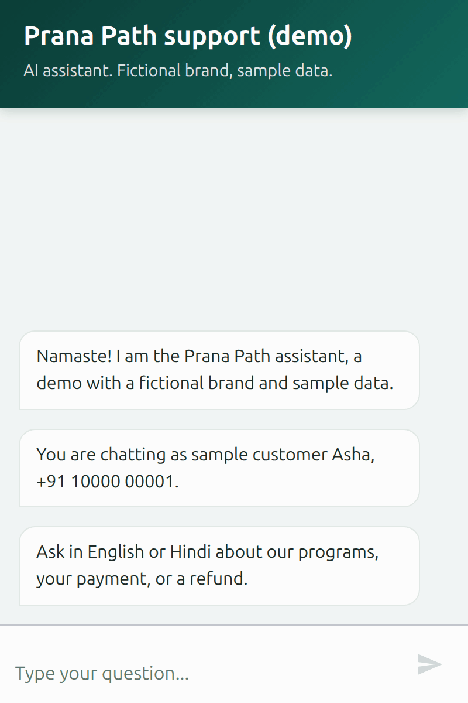
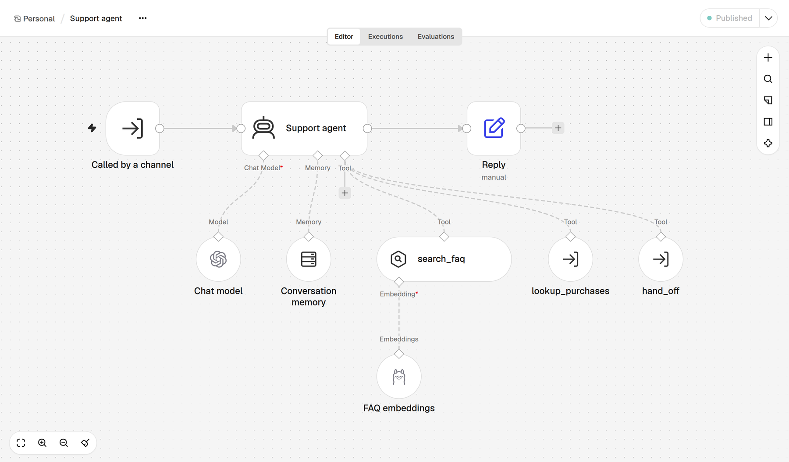
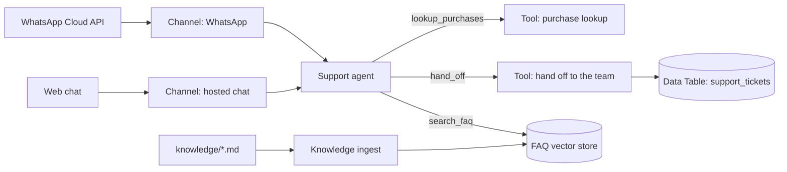
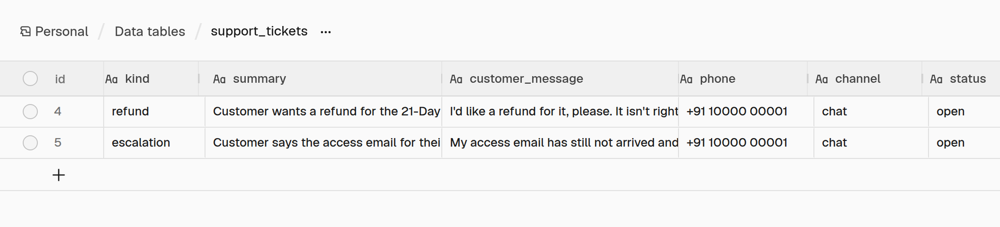
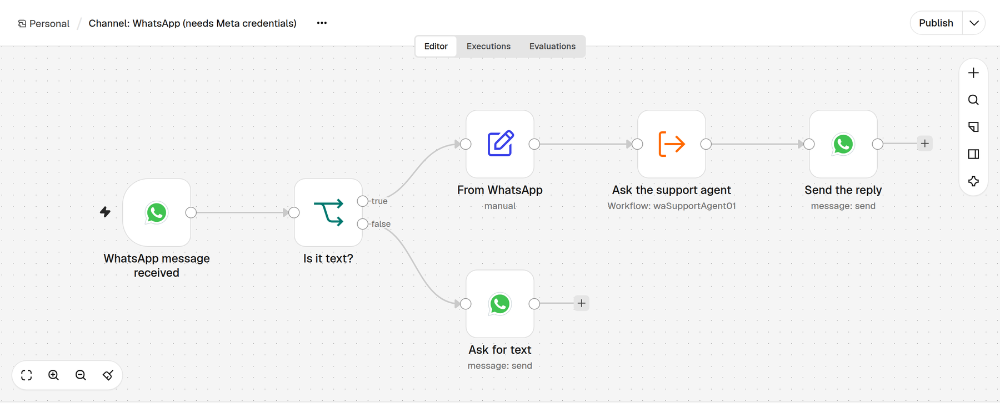

# WhatsApp AI support agent for n8n

A customer-support assistant built in n8n for a small online brand. Customers write to it on WhatsApp or in a web chat, in English or Hindi. It answers from the brand's own help docs, checks the customer's payments, and turns a refund request into a ticket for the team.

<p align="center">
  
</p>

Prana Path, the brand in this demo, is made up, and so are its policies and customers. The web chat has been tested end to end with a live model ([test run](docs/e2e-run.md)). The WhatsApp and Razorpay connections are built but haven't been run against live accounts yet (see [What has been tested](#what-has-been-tested)).

## What a customer can ask

| The customer writes | The assistant |
| --- | --- |
| When is your support team available? | Answers from the help docs: 10:00 to 18:30 IST, Monday to Saturday. |
| मुझे रिफंड माँगने के लिए कितने दिन मिलते हैं? | Answers in Hindi: a refund can be requested within 11 days of purchase. |
| Did my payment go through? | Looks up the payments made from the customer's own number and quotes the payment id. |
| I'd like a refund, please. | Checks the purchase and the refund policy, opens a ticket, and gives the customer the ticket number. |

When the docs don't cover a question, it says so and offers to pass the chat to a person instead of guessing. It answers in the language and script the customer writes in; the test run covers English, and Hindi in Devanagari.

## How it works



Both channels call the same agent, so answers and tickets are the same on WhatsApp and on the web chat.



| Workflow | File | What it does |
| --- | --- | --- |
| Channel: WhatsApp | `workflows/channel-whatsapp.json` | Receives WhatsApp messages, passes text to the agent, and sends the reply. Other message types get a short note asking for text. |
| Channel: hosted chat | `workflows/channel-chat.json` | A public web chat for demos. It speaks as sample customer Asha. |
| Support agent | `workflows/support-agent.json` | An AI Agent with any OpenAI-compatible chat model, a 10-message memory per conversation, and three tools. |
| Tool: purchase lookup | `workflows/tool-purchase-lookup.json` | Lists the payments made from the caller's phone number, from sample data shaped like Razorpay's payments API. |
| Tool: hand off to the team | `workflows/tool-handoff.json` | Creates the `support_tickets` table if it is missing, adds a ticket, and returns its id. |
| Knowledge ingest | `workflows/knowledge-ingest.json` | Reads `knowledge/*.md`, embeds it with Ollama (`nomic-embed-text`), and loads n8n's in-memory vector store. It runs when n8n starts, when the workflow is first published, and when you run it by hand. |

Refund requests and escalations land in an n8n Data Table, which you can swap for Google Sheets or Slack (see [Send tickets elsewhere](#send-tickets-elsewhere)):



### Who can see which payments

The phone number comes from the channel, never from the model. On WhatsApp it is the sender's number, which WhatsApp has verified; on the hosted chat, which has no verified number, it is the labelled sample customer. The `lookup_purchases` tool takes no input, so a customer cannot talk the agent into reading another number's payments.

## Run it locally

You need Docker with Compose and an API key for any OpenAI-compatible Chat Completions endpoint, such as OpenAI, DeepSeek, or OpenRouter.

1. Start n8n and Ollama. The first start downloads the embedding model, about 270 MB.

   ```sh
   docker compose up -d
   ```

2. Open http://localhost:5678 and create the owner account.
3. Import the workflows:

   ```sh
   docker compose exec n8n n8n import:workflow --separate --input=/workflows
   ```

4. In n8n, create two credentials:
   - **OpenAI**, named `LLM (OpenAI-compatible)`: your API key, and your provider's address in **Base URL** (for OpenAI, `https://api.openai.com/v1`).
   - **Ollama**, named `Ollama (local)`: **Base URL** `http://ollama:11434`.
5. Open **Support agent** and select these credentials in **Chat model** and **FAQ embeddings**. In **Chat model**, set the model id your provider uses; the workflow ships with `gpt-5-mini`. Then open **Knowledge ingest** and select the Ollama credential in its **FAQ embeddings** node.
6. Publish the workflows in this order: **Tool: purchase lookup**, **Tool: hand off to the team**, **Support agent**, **Knowledge ingest**, **Channel: hosted chat**. n8n runs a sub-workflow only from its published version, so publish a tool again after you edit it.
7. Open the chat at http://localhost:5678/webhook/5b1f3c2e-9a47-4d8e-b6a0-2f7c1d9e4a11/chat and try "When is your support team available?", "मुझे रिफंड माँगने के लिए कितने दिन मिलते हैं?", or "Did my payment go through?".

Tickets appear under **Overview → Data tables → support_tickets**. To use your own knowledge base, replace `knowledge/faq.md` with your Markdown files, then open **Knowledge ingest** and run it by hand (**Execute workflow**), or restart n8n. Publishing it again does not reload the files.

## Go live on WhatsApp



You need a Meta for Developers app with the WhatsApp product, a WhatsApp Business phone number, and an n8n instance that Meta can reach over HTTPS: n8n Cloud, or a self-hosted n8n behind a domain with TLS and `WEBHOOK_URL` set to that address.

1. In n8n, create a **WhatsApp OAuth API** credential named `WhatsApp trigger (Meta app)`, with your app's App ID as **Client ID** and its App Secret as **Client Secret**.
2. Create a **WhatsApp API** credential named `WhatsApp Cloud API`, with a permanent access token from a system user and your WhatsApp Business Account ID.
3. Open **Channel: WhatsApp**, select the credentials in the trigger and in both WhatsApp nodes, and publish it. The trigger registers its webhook with your Meta app and subscribes to incoming messages only; sent, delivered, and read receipts are dropped before they start an execution.
4. Send a WhatsApp message to the business number.

A Meta app has one webhook address, so only one published WhatsApp Trigger per app receives messages. The agent replies inside WhatsApp's 24-hour customer service window, so it needs no message templates.

## Connect real payments

Replace the Code node **Find payments for this phone** in **Tool: purchase lookup** with an HTTP Request node that calls Razorpay's `GET https://api.razorpay.com/v1/payments` with Basic auth (key id and key secret), and keep the Code node's filter and output fields after it. Keep the tool's single `phone` input, so identity still comes from the channel.

## Send tickets elsewhere

Swap the **Add ticket** node in **Tool: hand off to the team** for Google Sheets (append a row) or Slack (send a message) with the same fields, and return the row or message id as `ticket_id`.

## Running costs

Three things are metered: n8n executions, WhatsApp messages, and model tokens. Ollama runs on your own machine. Prices as published on 1 November 2026:

| Item | Price | Source |
| --- | --- | --- |
| n8n Cloud Starter | €20 a month billed annually, 2,500 executions | [n8n pricing](https://n8n.io/pricing/) |
| n8n Cloud Pro | €50 a month billed annually, 10,000 executions | [n8n pricing](https://n8n.io/pricing/) |
| n8n self-hosted Community edition | Free; you pay for the server | [n8n pricing](https://n8n.io/pricing/) |
| WhatsApp service messages | First 1,000 a month per business phone number free, then $0.0014 each in India (rate card effective 1 October 2026) | [Pricing on the WhatsApp Business Platform](https://developers.facebook.com/docs/whatsapp/pricing) |
| OpenAI `gpt-5-mini` | $0.25 input, $0.025 cached input, $2.00 output per 1M tokens | [OpenAI API pricing](https://developers.openai.com/api/docs/pricing) |
| DeepSeek `deepseek-flash` | $0.30 input (cache miss), $1.20 output per 1M tokens at peak hours, half that off-peak | [DeepSeek API pricing](https://api-docs.deepseek.com/quick_start/pricing) |

- n8n bills one execution per customer message. Each message runs the channel workflow once; the agent and its tools run as sub-workflows, and [n8n's documentation](https://docs.n8n.io/flow-logic/subworkflows/) says "sub-workflow executions don't count towards your plan's monthly execution or active workflow limits". Knowledge ingest adds one execution per restart.
- Meta charges per delivered message the business sends, and the agent sends one reply per customer message.
- In the [end-to-end run](docs/e2e-run.md), each reply took two or three model calls and, on average, about 3,600 prompt and 270 completion tokens in total, measured with DeepSeek V4.1 Flash through an OpenAI-compatible router (DeepSeek's own API names it `deepseek-flash`).

For example, 100 conversations a day of three customer messages each is about 9,000 messages a month. That fits n8n Cloud Pro or a self-hosted server. WhatsApp costs about 8,000 × $0.0014 ≈ $11 a month once the free 1,000 are used, and the model about 9,000 × $0.0014 ≈ $13 a month at `gpt-5-mini` list prices; DeepSeek `deepseek-flash` costs about the same at peak hours and half that off-peak. Cached input lowers both.

On n8n Cloud, Ollama and the Read/Write Files from Disk node are not available: load the FAQ with Google Drive or an HTTP Request node, and embed it with OpenAI embeddings instead.

## Tests

- **Fast suite**, about 30 seconds; needs Docker, and runs with no network:

  ```sh
  node --test tests/tools.test.mjs
  ```

  It imports all six workflows into a clean `n8nio/n8n:2.45.7` container, checks every node type and version against that release's node catalog, and runs the purchase lookup with the sample customer's number written three ways, plus an unknown and an empty number.

- **End-to-end run**, a few minutes; needs Docker, network access, and a model endpoint:

  ```sh
  LLM_BASE_URL=https://api.openai.com/v1 LLM_API_KEY=... LLM_MODEL=gpt-5-mini node tests/e2e.mjs
  ```

  It starts the Compose stack as project `n8n-wa-e2e` on port 5688, publishes the workflows, waits for the FAQ to be embedded, and holds four chats through the hosted chat: support hours in English, the refund window in Hindi, a payment check, and a refund request. It checks the replies and the n8n executions, writes `tests/out/e2e-transcript.md`, and then removes the stack and its n8n data. Set `KEEP_STACK=1` to leave the stack running when it ends; it prints the command that removes it. The latest passing run is in [docs/e2e-run.md](docs/e2e-run.md).

## What has been tested

- **On every change:** the fast suite above.
- **End to end, with a live model:** four chats through the hosted chat, in English and Hindi, covering an FAQ answer, a payment check, and a refund that becomes a ticket ([test run](docs/e2e-run.md)). The chats are scripted and use one model, so check answers with your own documents and model before going live.
- **Built, not yet run live:** the WhatsApp Cloud API channel is built from n8n 2.45.7's node definitions and loads in n8n, but it hasn't exchanged messages with Meta, which needs the business's Meta app and phone number. Payment lookups use sample data shaped like Razorpay's payments API.
- **Knowledge base:** n8n's in-memory vector store is rebuilt at every start. For large or often-changing documents, use a persistent vector store such as Qdrant, Supabase, or PGVector.

## Security notes

- The hosted chat is public and has no login, so anyone with its address can spend your model credits. Outside demos, turn on basic auth in the chat trigger or leave the workflow unpublished.
- The workflow files hold no credentials. Nodes refer to credentials by name, and keys stay in n8n's encrypted credential store.
- The agent is told never to ask for card numbers, CVV, UPI PIN, OTP, or passwords.
